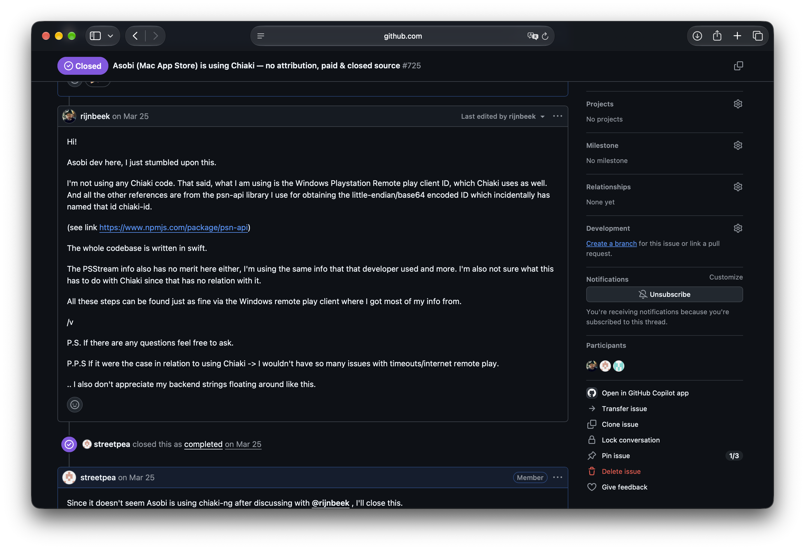
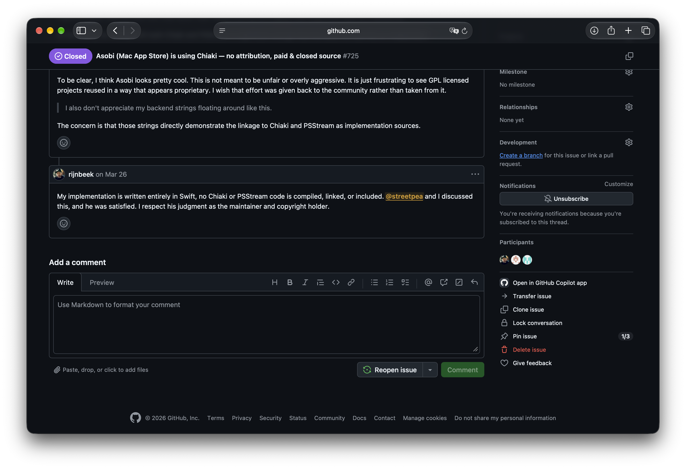
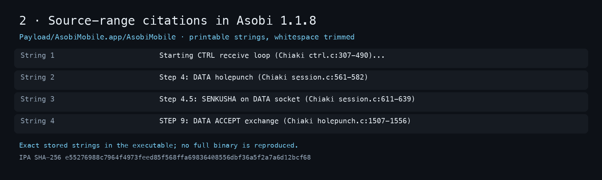
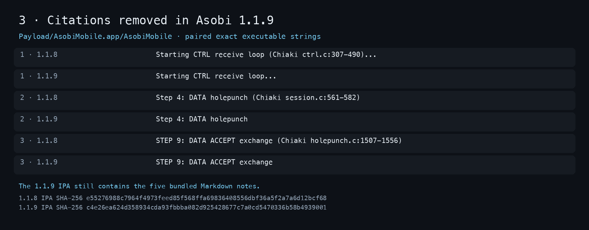
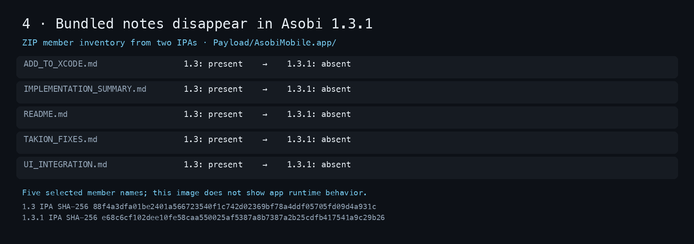

# Selected case exhibits

The first two images are **user-supplied screenshots of public GitHub comments**. The four IPA images are readable renderings of exact text and member names extracted from named iOS packages, not screenshots of the app running. Each IPA image identifies its ZIP member or executable and input SHA-256. Matching package hashes and their limited original-store association are in [release evidence](evidence/releases.json). The source packages are withheld. The excerpts avoid account data and full binaries.

## 0. The public denial

The user supplied these two screenshots of [GitHub issue #725](https://github.com/chiaki-ng/chiaki-ng/issues/725) on October 8. They show the developer's March 25 and March 26 comments; the first visibly carries GitHub's “Last edited” label. The screenshots' pixels are unchanged, and only ICC/XMP metadata was removed for publication. [Original and published hashes and the pixel check](evidence/github-screenshots.json) document that handling. The [dated GitHub API snapshot](evidence/developer-statements-issue-725.json) preserves issue dates, both comment IDs, full text, edit times and permalinks. Neither screenshot alone is a third-party historical archive.

[Open March 25 screenshot at full resolution](evidence/github-screenshots/march-25-denial.png)

[Open March 26 screenshot at full resolution](evidence/github-screenshots/march-26-swift-statement.png)

## 1. The bundled note

Asobi 1.1.8 contains `Payload/AsobiMobile.app/IMPLEMENTATION_SUMMARY.md` and `TAKION_FIXES.md`. The selected lines describe the implementation as based on Chiaki and cite its `takion.c` file. The [note hashes and signature chain](evidence/developer-notes.json) provide the stronger check: Apple's signature seals these resources in the examined original store packages.

## 2. The executable's source citations

Four log strings stored in the Asobi 1.1.8 executable identify Chiaki source files and line ranges. The [attribution record](evidence/attribution.json) maps those ranges to a pinned chiaki-ng version and distinguishes authors. A source citation is strong provenance evidence; it does not show that every cited instruction was copied.

## 3. The 1.1.9 edit

These paired strings are read directly from the Asobi 1.1.8 and 1.1.9 executables. The source references disappear while the surrounding operation names remain. [The complete measured changes](evidence/removals.json) include other Chiaki and PSStream references. This comparison establishes a wording change, not the developer's motive.

## 4. The notes disappear

All five selected Markdown members are in the Asobi 1.3 IPA and absent from the 1.3.1 IPA. Their [per-release hashes and seal checks](evidence/developer-notes.json) show they were unchanged through 1.3. This is a ZIP member comparison; it does not by itself say why they were removed.

To reproduce the images from independently obtained matching packages, install Pillow and run `python3 tools/render_ipa_exhibits.py --ipa-1-1-8 <file> --ipa-1-1-9 <file> --ipa-1-3 <file> --ipa-1-3-1 <file> --out <folder>`. The script checks each input hash and `Info.plist` version, selects only the displayed archive members and strings, and writes PNGs without source paths or embedded metadata.
