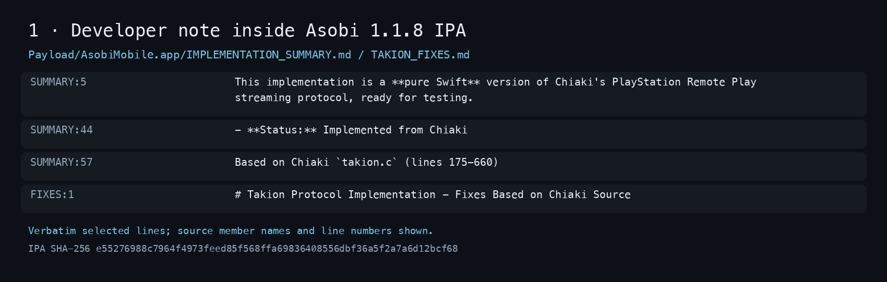

# Asobi: what the developer said, and what the app contains

| The developer's public account | Evidence in the shipped app |
| --- | --- |
| “I'm not using any Chiaki code.” ([March 25 screenshot](evidence/github-screenshots/march-25-denial.png)) | Asobi's own bundled note calls its implementation a “pure Swift” version of Chiaki's streaming protocol and says parts were “Implemented from Chiaki.” [See the note in the IPA](EXHIBITS.md#1-the-bundled-note). |
| Most of the information came from Sony's Windows Remote Play client. ([same screenshot](evidence/github-screenshots/march-25-denial.png)) | Asobi's executable contains **four log messages citing three Chiaki source files and line ranges**. Several implementation choices in Asobi also match chiaki-ng but were not found in the examined Sony client. [See the executable strings](EXHIBITS.md#2-the-executables-source-citations) and [comparison](FINDINGS.md#contrary-evidence-and-unresolved-questions). |

The [statements are on chiaki-ng issue #725](https://github.com/chiaki-ng/chiaki-ng/issues/725). We preserved the [comment text, IDs and edit times](evidence/developer-statements-issue-725.json) and saved [March 25](evidence/github-screenshots/march-25-denial.png) and [March 26](evidence/github-screenshots/march-26-swift-statement.png) GitHub screenshots, so a later edit cannot silently change this record. The note below is a short, traceable excerpt from the Asobi 1.1.8 IPA, not an app UI screenshot.

**What happened next:** About a day after the March 25 public denial, Asobi 1.1.9 removed “Chiaki” from 34 executable strings and “PSStream” from two, while keeping the bundled notes. [See the before/after image](EXHIBITS.md#3-the-1-1-9-edit). The notes remained through 1.3 and [disappeared in 1.3.1](EXHIBITS.md#4-the-notes-disappear).

| When | Event |
| --- | --- |
| February 13, 2026, about | Asobi 1.1 was packaged with cloud-streaming messages referring to PSStream. |
| March 16 | A third party opened [issue #725](https://github.com/chiaki-ng/chiaki-ng/issues/725) raising the Chiaki attribution concern. |
| March 25–26 | The developer denied using Chiaki code on [issue #725](https://github.com/chiaki-ng/chiaki-ng/issues/725). |
| March 26, about | Version 1.1.9 removed the source references from log messages. [Comparison](evidence/removals.json). |
| April 30, about | Version 1.3.1 no longer contained the five developer notes. [IPA images](EXHIBITS.md#4-the-notes-disappear). |

**Where the case stands:** The developer's own notes and executable messages are strong evidence that Chiaki informed Asobi's development. The [separate PSStream comparison](evidence/psstream-steam-build.json) adds dated cloud-streaming wording, with important limits. These findings do not by themselves establish how much protected source code was adapted, the exact licensing scope, or whether separate permission or release-matched source exists. The audit seeks the release-matched source and licensing basis for review.

[View all four IPA images](EXHIBITS.md) · [Full findings and limits](FINDINGS.md) · [Evidence index](EVIDENCE.md) · [Rights-holder scope](RIGHTS-HOLDERS.md)

This curated review package is currently staged privately. It includes selected IPA excerpts, not app archives or private correspondence. No complaint or issue update has been sent from this audit. `python3 tools/verify_public.py` checks the package.
