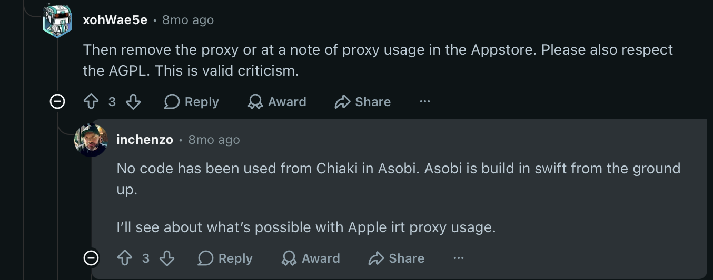
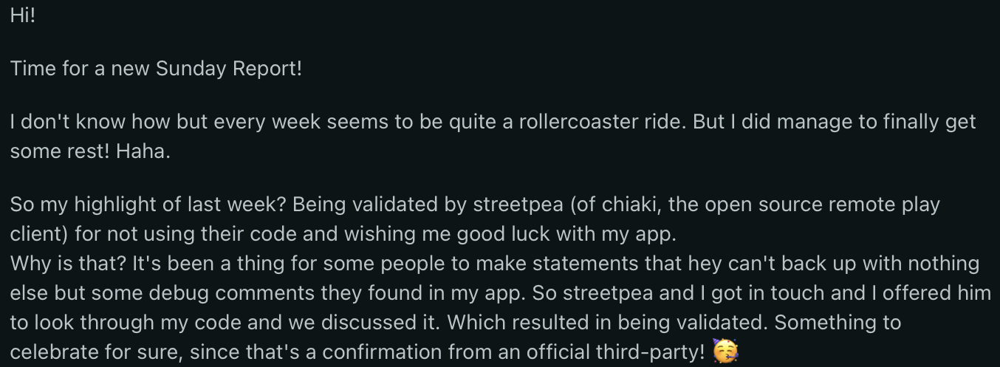
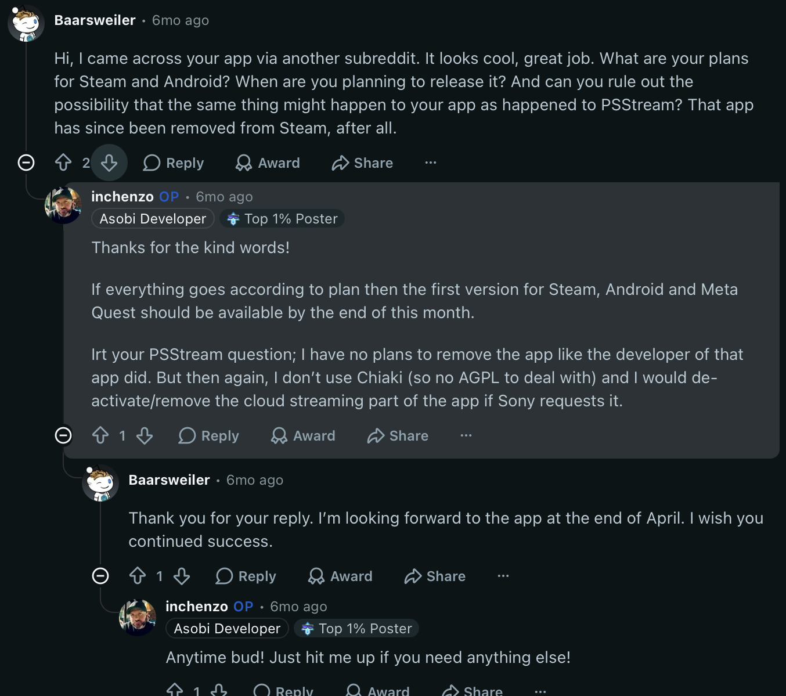
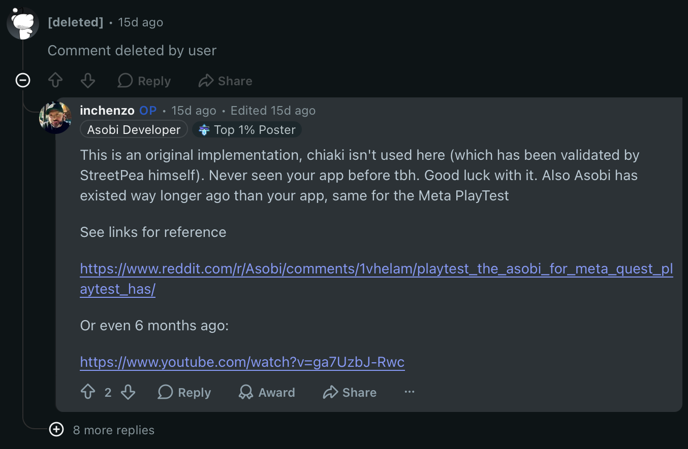

# The Asobi developer's statements on Reddit

Statements by u/inchenzo, the Asobi developer, about Asobi's implementation, Chiaki, the AGPL, PSStream and the #725 closure. Text is from the PullPush archive of public Reddit as archived at ingest; each permalink lets anyone compare the live text. His statements accusing other developers are omitted, and cuts are marked […]. Record: [developer-statements-reddit.json](developer-statements-reddit.json).

**Live check, October 11, 2026:** Street Pea compared four statements with the live Reddit pages and took screenshots ([handling and hashes](reddit-screenshots.json)). February 14 and April 13 match the archive. **March 29 differs in one phrase:** the archive, copied 23 seconds after posting, ends “since that's a conversation of an official third-party!”; the live post ends “since that's a confirmation from an official third-party!”. **September 26 has been edited:** the live comment is marked “Edited 15d ago” and adds “chiaki isn't used here (which has been validated by StreetPea himself)” and two links; the archive holds the earlier wording. The comment it replied to has since been deleted by its author. The other statements were not compared live.

## 2025-12-01 · r/VisionPro · comment

[permalink](https://www.reddit.com/r/VisionPro/comments/1p8u7nc/asobi_remote_play_for_playstation_launch_black/nrr3v18/) · archived text SHA-256 `e248ea8ecb614a2991fd09ad12a7d38dcfc185cabb47ef278ad3181bdf26ad5a`

````text
Chiaki is what most of these clients are based on, the main difference is the Apple framework as to go about things. It's a uphill battle sometimes. Chiaki also uses FFMpeg which I'm not allowed to. Still there's ways to go about this. I've had zero lag builds, but it created framedrops. I'll balance it out eventually.

I had a couple of features done already, which were from before the 1.0 release dropped. These will be released with the next update, but main focus is stability for now.

Cheers man!
````

## 2026-01-25 · r/Asobi · comment

[permalink](https://www.reddit.com/r/Asobi/comments/1qmqbaf/windows_app_development/o1ns9p3/) · archived text SHA-256 `5cec8355b74d9c2d982db49570338ad74f177bea275901e6abab4c96e07490c3`

````text
I've thought about it to be honest, as in making an android, windows, linux versions. You're definitely not the first to ask. The issue is that I've always mainly been an Apple developer (although I've dabbled with Android apps in the past for clients) and the hard fact that this is completely written in swift, this would mean that I have to rewrite the complete app to support the other platforms. So honestly, on the short term it's a hard no. 

But never say never, so maybe in the future?

p.s. the biggest factor would be if there's enough interest tbh.

  
/v
````

## 2026-01-27 · r/Asobi · comment

[permalink](https://www.reddit.com/r/Asobi/comments/1qnkxln/version_11/o2008jz/) · archived text SHA-256 `700aa5378aa57d0ee7bd89eff3b04465c60e4d0d0952517f15a62a135a340729`

````text
I heard about psstream about a week ago (didn't know it existed, I guess this was the other person that had cloud streaming) […]
````

*Remainder concerns another developer and is omitted.*

## 2026-02-14 · r/remoteplay · comment

[permalink](https://www.reddit.com/r/remoteplay/comments/1r4p0n1/observations_from_a_technical_analysis_of_asobi/o5d9919/) · archived text SHA-256 `d1100a3b9334a53fd84e9d114785f7e3512a142c74287b97eae6ca7d52f3b196`

````text
Hi,

Asobi dev here. To keep it simple and clear; I warned my own users by sharing the warning on my own subreddit. I kept it out of other subreddits like this one (compared to you).

Quite some acquisitions here. I'll keep it short and simple;

1. Nothing's being stored here, it's just purely a proxy for the PSN api endpoints to keep users safe.
2. Everything's build in swift from the ground up, other than that your and my app are build on the same principles
3. Nothing of risk that will get you banned, perfectly within the rate limits.

Good luck with your app, and please get your stuff sorted. Instead of shitting on other devs like myself and [u/grill2010](https://www.reddit.com/user/grill2010/) like you invented sliced bread.

I've been coding since i was a little kid, for me personally this really wasn't that complex to build. And sorry for being so social as well. 🥳

Peace out.

/v
````

## 2026-02-14 · r/remoteplay · comment

[permalink](https://www.reddit.com/r/remoteplay/comments/1r4p0n1/observations_from_a_technical_analysis_of_asobi/o5dexul/) · archived text SHA-256 `47558a393be643fbb85449b485c57719bd700f069d6f150af865bc905634f7e8` · live check: 2026-10-11, matches archive

````text
No code has been used from Chiaki in Asobi. Asobi is build in swift from the ground up. 

I’ll see about what’s possible with Apple irt proxy usage.
````



## 2026-02-15 · r/VisionPro · comment

[permalink](https://www.reddit.com/r/VisionPro/comments/1r4ozti/observations_from_a_technical_analysis_of_asobi/o5ha139/) · archived text SHA-256 `6a1ea9ee036c468a8df87b9042f750b94622559dae39a0d09c9d19ba81808432`

````text
Morning! So last one I’m responding to in this post,

No, I’m not using the Chiaki framework. Easy tell is the binary size btw. I think it’s about 15MB on vision / 30MB on macOS -> Chiaki is way bigger than that ( kinda proud of how small I got my app)

What I do use however is the ChiakiID version of the PlayStation account id, simply because I like the way it’s encrypted and easily spotted when I’m in debug mode; a design choice. My proxy/api converts it at runtime from the PSN api response. Real basic stuff but convenient.
 
It’s base64/little endian which I decrypt when connecting to a local account.

Also, if I did use Chiaki then I wouldn’t have had so many bugs to squash and would’ve been way easier to bring to the public.
But no, I had to make my own remote play client,.. 🫠

Enjoy the rest of the show, I’ve got bugs to squash and packets to analyze 🥳
````

## 2026-03-28 · r/Asobi · comment

[permalink](https://www.reddit.com/r/Asobi/comments/1s3o491/asobi_version_119_release_notes/od140e1/) · archived text SHA-256 `16cf9960f98f2d53eb34a683eb1965a789cd0eed02964b9a9574ab4eab47986d`

````text
There are testflight running, but due to low capacity on my end I try to keep this small and personal. Maybe in the future? Send me a DM with email address and we could look into it.   
  
Also, nice of you to send a message here so I can respond; I saw your message earlier on an old topic. Not trying to ignore you, just not interested in engaging since the OP of that topic has been trying his best to get rid of me. Luckily I've discussed the matter with streetpea (copyright owner of chiaki ) and have been validated. Which is nice :)
````

## 2026-03-29 · r/Asobi · post: [Sunday Report] Week 14

[permalink](https://www.reddit.com/r/Asobi/comments/1s6uzta/sunday_report_week_14/) · archived text SHA-256 `e696fc1e5b71c95468f4a4014cc97bb96fdfa4fa235100528893108789eaf816` · live check: 2026-10-11, matches archive

````text
Hi!

Time for a new Sunday Report!

I don't know how but every week seems to be quite a rollercoaster ride. But I did manage to finally get some rest! Haha.

So my highlight of last week? Being validated by streetpea (of chiaki, the open source remote play client) for not using their code and wishing me good luck with my app.   
Why is that? It's been a thing for some people to make statements that hey can't back up with nothing else but some debug comments they found in my app. So streetpea and I got in touch and I offered him to look through my code and we discussed it. Which resulted in being validated. Something to celebrate for sure, since that's a conversation of an official third-part …
````

*Excerpt around the relevant passage; full post at the permalink.*



## 2026-03-29 · r/remoteplay · comment

[permalink](https://www.reddit.com/r/remoteplay/comments/1s71bwd/asobi_remote_play_is_coming_to_android_steam_meta/od6dqfv/) · archived text SHA-256 `440d1bb5a66011dec795a8f6c7b811e87354a5f540c50e3ce4769588e8e3d446`

````text
Well Chiaki is the OG 🐐 of course. That said, it's a new built from the ground up PS remote player. The only thing in common is the use of the same Windows Remote Play identifier, since Sony still uses that one as well. But I'll point you to a different comment in this thread to give you a general idea; [https://www.reddit.com/r/remoteplay/comments/1s71bwd/comment/od6cf96/](https://www.reddit.com/r/remoteplay/comments/1s71bwd/comment/od6cf96/)
````

## 2026-04-13 · r/Asobi · comment

[permalink](https://www.reddit.com/r/Asobi/comments/1sjlept/sunday_report_week_16/ofwe9am/) · archived text SHA-256 `f6ee1ea1f22605e4e7d70cc52d80d216029a687721cbbc760fc162d1c4afd6e0` · live check: 2026-10-11, matches archive

````text
Thanks for the kind words!

If everything goes according to plan then the first version for Steam, Android and Meta Quest should be available by the end of this month.

Irt your PSStream question; I have no plans to remove the app like the developer of that app did. But then again, I don’t use Chiaki (so no AGPL to deal with) and I would de-activate/remove the cloud streaming part of the app if Sony requests it.
````



## 2026-04-20 · r/Asobi · comment

[permalink](https://www.reddit.com/r/Asobi/comments/1sock3o/update_asobi_version_121_for_iphone_and_ipad_are/ohac34j/) · archived text SHA-256 `d89cf5057fa329404592d9e84dc4a0c67dbe013fd0c689924c595417b94c2690`

````text
First off; The experimental features will be able to be persist again from the next update. Sorry for the inconvenience.

So there's pretty much 4 actual original remote play implementations; the official Playstation one, PXPlay, Asobi and Chiaki (which is being used without proper licensing by all apps not named here -> I checked 🤫)   
  
The issue is that Asobi's quite young for an original implementation (6 months now), so there are still some issues with frame pacing for some users. Which is why certain experimental options are in there. That said, I'm pretty much working around the clock to fix what I can and which is also one of the reasons as to why there's weekly updates to the app. (besides the cool stuff)

In your case it's about figuring out if it's a stutter caused by either AWDL (WiFi channel hopping by Apple), Packet loss on your network, or that it's the app -> or a combination of these factors.

So first thing to check is, what latency mode do you have it set to; the lowest one "competition" mode will result in dropped packets when you have an unstable connection. Also, what wifi are you connected to? 2.4Ghz, 5Ghz or 6 GHz?  
  
FYI Bitrate shouldn't be an issue in this case. Other than that, yeah the FEC mode could help. 

Let me know!
````

## 2026-05-01 · r/Asobi · comment

[permalink](https://www.reddit.com/r/Asobi/comments/1t15gav/looking_to_start_using_asobi_just_some_questions/oje3dip/) · archived text SHA-256 `9b7a9741fa8f7d9234c8ef7e1dad3f1436e7c26c5dfc356ef1ef9f05aa80a27b`

````text
Yeah, there’s a competitor that’s not too happy with me 😂

So Asobi’s built on the same base principles like r/PXPlay and r/Chiaki. They use the same basis since we all built our apps based on reverse engineering the official PS remote play app.

FYI: your credentials or rather the token you use is safely stored on your device. Even if I had access to it, I wouldn’t be able to do much with it.

Local play only uses your username to connect to your PlayStation, so no cloud play or extra features that add to the experience.

If I had any bad intent then it wouldn’t make sense to push weekly updates and engage with the community at this pace. Tbh, maybe check the Asobi youtube channel; it has interviews and such with me. https://youtube.com/@asobiapp

At the end of the day, the decision is pretty much up to you.

And if you have any questions: hit me up anytime.

/v
````

## 2026-07-01 · r/Asobi · post: [Midweek Update] Status on Steam Deck release, and Apple updates.

[permalink](https://www.reddit.com/r/Asobi/comments/1uky4kf/midweek_update_status_on_steam_deck_release_and/) · archived text SHA-256 `2220cf7ae736bfbfbfeaf52cf5415b4ec8b71428307f17c6adb43c44083956cb`

````text
Hi,

Time for a quick midweek update! 

**Steam Deck**

I've hit a snag: Steam's review flagged a notification that Asobi may incorporate third-party intellectual property. They weren't specific about what triggered it, so I'm looking at two paths: hire an IP lawyer to identify and resolve it (which gets expensive), or find and change whatever's flagging it on my end.

Until this is resolved, I can't launch on the Steam Store. The Play Test itself should still get through review, the input issues they flagged there are already fixed in a new build. The launch version is the uncertain part.

So anyone know a cheap IP lawyer? 👀

  
**Asobi for Apple**

**I've got some great stuff cooking for t …
````

*Excerpt around the relevant passage; full post at the permalink.*

## 2026-07-19 · r/Asobi · comment

[permalink](https://www.reddit.com/r/Asobi/comments/1v0mt6k/bigs_lags/oyhi9ot/) · archived text SHA-256 `998c5bc3acd242fe528b55222f3af8c04515543ac07434b1daa76878823ea419`

````text
It’s still on my todo. And should be picked up either next week or the week after. It’s not forgotten, just more of a priority situation. Kind of the consequence of creating my own implementation of a remote play client compared to just copying it from others.
````

## 2026-07-19 · r/Asobi · post: [Sunday Report] Edition 20, Week 30: The 411

[permalink](https://www.reddit.com/r/Asobi/comments/1v0v64c/sunday_report_edition_20_week_30_the_411/) · archived text SHA-256 `84870ec495394f729930eb3811f6a516ae8920b885cb7e312ea596f7de4af082`

````text
… ty much everything I've shipped has been possible since at least the iPhone 15 (2023). I think they just got complacent.

The only thing I do have to ask is to have patience with me while I keep building and pushing out updates. The choice to make my own remote play client instead of just baking in Chiaki (the open source remote player) like most competitors do was for a reason.

And that reason was control, to not having to worry about my app being taken down because of licensing issues (Chiaki AGPL) or having to abide by opinionated code. 

The downside is that everyone else (except for PXPlay) using Chiaki has a five-year head start on me, since I don't have the luxury they have by using …
````

*Excerpt around the relevant passage; full post at the permalink.*

## 2026-08-12 · r/SteamDeck · comment

[permalink](https://www.reddit.com/r/SteamDeck/comments/1vjplus/steam_deck_gets_one_of_ps_portals_key_features/p3995l5/) · archived text SHA-256 `7eae12fdd4ac826948e96c8d0a55e18a95f377feaadb4c68de9c8349cf9e9614`

````text
I fear that if I make it open source, would in fact make Sony go after me. Which I'm quite certain about tbh.
````

## 2026-08-12 · r/Asobi · comment

[permalink](https://www.reddit.com/r/Asobi/comments/1vbyz5b/help_wanted_asobi_version_142_internet_remote/p3at6ir/) · archived text SHA-256 `bea3c3f8d3d97069c4d049a09c86dc7ddb737e0d61e1510aa132aca6dc28162d`

````text
Someone tried this actually to take me down via Chiaki […], which months ago resulted in a ticket being opened on chiaki-ng. Luckiliy I've been in touch with Streetpea back then as well, which was settled and closed (which you can look up).
````

*A parenthetical about another developer is omitted.*

## 2026-08-13 · r/Asobi · post: Asobi Version 1.4.2 release notes "The one where we can all feel it"

[permalink](https://www.reddit.com/r/Asobi/comments/1vnq7hg/asobi_version_142_release_notes_the_one_where_we/) · archived text SHA-256 `da1c584bad5d9c5d6d401865d3182547be85a193feac6d5136a3bebf82f80de7`

````text
… ting. Originally version 1.4.2 was supposed to be a bigger update, but decided against it at the last moment (you'll see)

However, we now not only have TURN relay support in beta (for difficult internet connections), but also an updated Internet Remote Play implementation which I reworked from the ground up. I hope this will solve all your issues! If not, then please report it.

Other than that we also have an alternative renderer for Apple TV, we finally have 3D modes for Mac, and some much needed cloud gaming tweaks.

I still have a lot planned for you guys, so hopefully the next update won't take as long.

More next week!

**# General**

\- Native adaptive triggers over Bluetooth (Worlds …
````

*Excerpt around the relevant passage; full post at the permalink.*

## 2026-08-14 · r/Asobi · comment

[permalink](https://www.reddit.com/r/Asobi/comments/1vnq7hg/asobi_version_142_release_notes_the_one_where_we/p3m0pve/) · archived text SHA-256 `d04c3e0973c5bcbe505f3e9c5946542efc2a9d6c4c638742fd5d7938bd92116b`

````text
Just so you know, I've had Cloud streaming around the same time as PSStream had. And I'm still here.
````

## 2026-08-14 · r/Asobi · comment

[permalink](https://www.reddit.com/r/Asobi/comments/1vnq7hg/asobi_version_142_release_notes_the_one_where_we/p3m92a7/) · archived text SHA-256 `039fe95c1313e74cb3a0a9543d0f82f65b56f8b606b1e765b0b974b30ef4b2f6`

````text
I dunno man. I've spoken to him at some point later on when it was pulled already. I actually missed the whole launch of PSStream back then.

Either way, Asobi's now close to a year old. I started on Apple devices, and later added Android and since last week on the Meta and Steam platforms
````

## 2026-09-05 · r/Asobi · comment

[permalink](https://www.reddit.com/r/Asobi/comments/1w7sri3/steam_deck_stick_dead_zone_issue/p7xe8ah/) · archived text SHA-256 `df4b0f6a4428aa24c308a818fd5488c3a6c7bbc0ee0936358aef509368aa90dc`

````text
Thanks for reporting, would you mind reporting this in the comment section of https://www.reddit.com/r/Asobi/comments/1w4unsg/asobi\_for\_steam\_beta\_build\_10\_release\_notes/

That way I can track it.

FYI: this is an original implementation of remote play, which means Asobi ≠ Chiaki
````

## 2026-09-16 · r/Asobi · comment

[permalink](https://www.reddit.com/r/Asobi/comments/1why659/asobi_for_steam_beta_build_12_release_notes/pa713bv/) · archived text SHA-256 `d5ec57a6350ccb2e7479b67b544bac6b6fa7191482ac69847bb086cfd8ceaf47`

````text
Which is the difference between an actual new remote play implementation vs someone just riding on Chiaki which has been developed over years
````

## 2026-09-26 · r/Asobi · comment

[permalink](https://www.reddit.com/r/Asobi/comments/1vhelam/playtest_the_asobi_for_meta_quest_playtest_has/pc7ddg6/) · archived text SHA-256 `061b3f20ace907bc493192e94790a5bac76446bf6fe08aab340485080ab469e6` · live check: 2026-10-11, edited: live text differs from archive

*Context:* Reply to u/0TheRain0 (Horizon Stream for PlayStation, a Quest app based on Android Chiaki), who had written that Asobi's Quest version was highly derivative of it.

**Archived text:**

````text
This is an original implementation. Never seen your app before tbh. Good luck with it.
````

**Live text on October 11, 2026 (edited; transcribed from the screenshot):**

````text
This is an original implementation, chiaki isn't used here (which has been validated by StreetPea himself). Never seen your app before tbh. Good luck with it. Also Asobi has existed way longer ago than your app, same for the Meta PlayTest

See links for reference

https://www.reddit.com/r/Asobi/comments/1vhelam/playtest_the_asobi_for_meta_quest_playtest_has/

Or even 6 months ago:

https://www.youtube.com/watch?v=ga7UzbJ-Rwc
````


